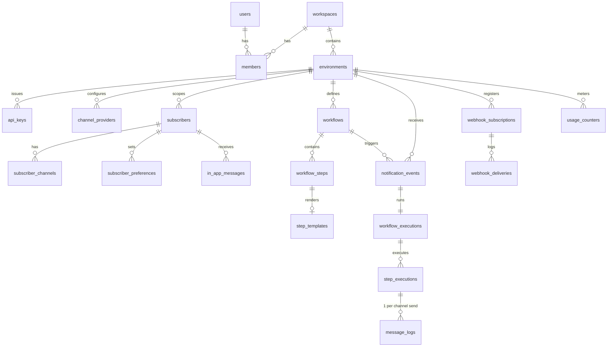

# NOTIFORA — Product Requirements Document (PRD)
**Version:** 2.1.0 (Development-Ready)
**Status:** Final untuk implementasi — semua keputusan arsitektur di bawah sudah dikunci (lihat §13 Decision Log)
**Produk:** Multi-Channel Notification Gateway & Workflow Orchestrator (developer-first)
**Stack:** PHP 8.2+ / Laravel 12, MySQL 8.0, Redis 7, Blade + Alpine.js + Tailwind CSS 4 + Vite, Node.js 20 (socket engine)
**Maintainer:** Ryan (CTO / Founder) — PT Destinara / PT Flustra Tech Ventures

> Dokumen pendamping: [BACKEND_SPEC.md](BACKEND_SPEC.md) (implementasi server) dan [FRONTEND_SPEC.md](FRONTEND_SPEC.md) (console & UI). Jika ada konflik, urutan prioritas: **PRD → BACKEND_SPEC → FRONTEND_SPEC**.

---

## DAFTAR ISI
1. [Ringkasan Eksekutif & Brand](#1-ringkasan-eksekutif--brand)
2. [Arsitektur Sistem](#2-arsitektur-sistem)
3. [Tech Stack & Struktur Repo](#3-tech-stack--struktur-repo)
4. [Domain Model & ERD](#4-domain-model--erd)
5. [State Machines](#5-state-machines)
6. [Modul & Fitur (dengan Acceptance Criteria)](#6-modul--fitur)
7. [Provider Abstraction Layer](#7-provider-abstraction-layer-pal)
8. [API Contract](#8-api-contract)
9. [In-App Feed & WebSocket Protocol](#9-in-app-feed--websocket-protocol)
10. [Infrastruktur & Deployment](#10-infrastruktur--deployment)
11. [Keamanan, Rate Limit, Resilience](#11-keamanan-rate-limit-resilience)
12. [Non-Functional Requirements, Pricing & Roadmap](#12-nfr-pricing--roadmap)
13. [Decision Log](#13-decision-log)
14. [Instruksi untuk AI Agent / Developer](#14-instruksi-untuk-ai-agent--developer)

---

## 1. RINGKASAN EKSEKUTIF & BRAND

### 1.1 Visi
**Notifora** adalah gateway notifikasi terpadu: satu API untuk mengirim notifikasi transaksional ke **WhatsApp, Email, Telegram, In-App Inbox** (MVP) dan **Push, SMS, Slack, Webhook** (fase lanjut). Notifora menangani templating, preferensi subscriber, delay, retry dengan backoff, fallback antar-channel, dan log pengiriman — sehingga developer tidak perlu mengelola banyak SDK provider.

### 1.2 Persona
1. **Backend/Fullstack Engineer** — ingin 1 endpoint untuk banyak channel, retry & fallback otomatis.
2. **SaaS Founder / Eng Lead** — ingin In-App Notification Center (ikon lonceng) tanpa membangun WebSocket server sendiri.
3. **Ekosistem internal** — backbone notifikasi untuk Cravacloud, Pesanvo, VexaHost, Destinara.

### 1.3 Brand & Domain (final)
| Item | Nilai |
|---|---|
| Marketing site | `https://notifora.my.id` |
| Console | `https://notifora.my.id/console` |
| API | `https://api.notifora.my.id` (versi: `/v1`) |
| Docs | `https://notifora.my.id/docs` |
| Socket | `wss://ws.notifora.my.id` |
| Email | `noreply@notifora.my.id` (pengirim sistem), `support@notifora.my.id` (bantuan & reply-to) |
| Warna | Cobalt `#0033FF`, Jet Black `#0D0D0D`, Concrete `#E3E7EE` |

### 1.4 Ruang Lingkup MVP vs Non-Goals
**MVP (rilis 1.0):** trigger API, workflow linear (channel step, delay, filter/kondisi sederhana), channel WhatsApp (VexaHost), Email (Postivo), Telegram, In-App; subscriber & preferensi; template variabel; message log; API key; webhook outbound bertanda tangan HMAC; console; usage metering; billing manual (invoice) .
**Non-goals 1.0:** Push (FCM/APNs), SMS, Slack, digest engine, DAG bercabang paralel, drag-and-drop canvas, SDK resmi multi-bahasa, billing otomatis payment gateway. Semua masuk roadmap (§12.3).

---

## 2. ARSITEKTUR SISTEM

```
[ Client Apps / Backend ]
        │ HTTPS  Authorization: Bearer ntf_live_xxx
        ▼
┌──────────────────────────────────────────────────────────────┐
│ INGRESS — Laravel 12 (php-fpm + nginx, :8040)                │
│  ValidateApiKey → RateLimit (Redis) → IdempotencyGuard       │
│  → validasi → simpan notification_event → dispatch job → 202 │
└───────────────────────────────┬──────────────────────────────┘
                                ▼
┌──────────────────────────────────────────────────────────────┐
│ REDIS 7 (queue + cache + rate limit + pub/sub)               │
│  notifora_high │ notifora_default │ notifora_channels │      │
│  notifora_webhooks                                           │
└───────────────────────────────┬──────────────────────────────┘
                                ▼
┌──────────────────────────────────────────────────────────────┐
│ WORKER (Supervisor: queue:work redis)                        │
│  ProcessWorkflowEventJob → WorkflowEngine → per step:        │
│   • cek preferensi subscriber • render template              │
│   • DispatchChannelStepJob → Provider (PAL) → message_logs   │
│   • delay: dispatch delayed • gagal: fallback_step_id        │
│  Publish in-app ke Redis channel `notifora:inapp-stream`     │
└───────┬──────────────────────────────────────┬───────────────┘
        ▼                                      ▼
 [ Provider eksternal ]               [ SOCKET ENGINE Node :8042 ]
 VexaHost WA :8051 · Postivo ·        JWT verify · room per subscriber
 Telegram Bot API                     · unread badge
        │ delivery webhook
        ▼
 [ Webhook Ingress /v1/hooks/{provider} ] → update message_logs → DeliverCustomerWebhookJob
```

**Prinsip:**
- Ingress **tidak pernah** memanggil provider secara sinkron. Respons `202 Accepted` target p95 < 50 ms (di luar jaringan).
- Semua tabel bertenant memakai `environment_id` (scoping dilakukan di global scope + FK; tidak ada query tanpa scope).
- Satu Redis, DB number terpisah: `0` cache, `1` queue, `2` rate limit/idempotency.

---

## 3. TECH STACK & STRUKTUR REPO

| Layer | Teknologi | Catatan |
|---|---|---|
| Backend | PHP 8.2+, Laravel 12 | Service layer, Eloquent, Form Request, Policies |
| DB | MySQL 8.0 (InnoDB, utf8mb4_unicode_ci), DB `notifora_db` | Primary key UUID (ULID dipakai pada tabel log volume tinggi) |
| Queue/Cache | Redis 7.2 + Supervisor (`queue:work`) | Horizon ditunda: butuh ext-pcntl/posix (tidak ada di Windows dev); bisa ditambahkan di Docker kapan saja |
| Auth console | Session + Laravel Fortify-style (login, register, 2FA TOTP, reset password) | Bukan Sanctum |
| Auth API | Custom API key (`ntf_live_` / `ntf_test_`), hash SHA-256 | Bukan Sanctum |
| Frontend console | Blade + Alpine.js 3 + Tailwind 4 + Vite 7 + Chart.js 4 | Tanpa React di console |
| Marketing & auth page | Dikonversi ke Blade (dari prototype HTML/React di `templates/`) | Lihat FRONTEND_SPEC §3 |
| Socket | Node.js 20 + Socket.io 4 + ioredis | JWT-verified |
| Deploy | Docker Compose / Coolify, Nginx, Linux VPS | §10 |
| Testing | Pest (feature/unit), Playwright (E2E console), k6 (load) | CI wajib hijau |

```
notifora/
├── app/
│   ├── Enums/ (ChannelType, ExecutionStatus, MessageStatus, StepType, MemberRole, EnvironmentType)
│   ├── Http/
│   │   ├── Controllers/Api/V1/ (EventTriggerController, SubscriberController, SubscriberPreferenceController,
│   │   │                         InboxController, InboxTokenController, WorkflowReadController, MessageController, ProviderWebhookController)
│   │   ├── Controllers/Console/ (Dashboard, Workflow, Subscriber, ChannelProvider, MessageLog, ApiKey, Webhook, Team, Billing/Usage)
│   │   ├── Controllers/Auth/
│   │   ├── Middleware/ (ValidateApiKey, ApiRateLimit, IdempotencyGuard, SetCurrentEnvironment)
│   │   └── Requests/
│   ├── Jobs/ (ProcessWorkflowEventJob, DispatchChannelStepJob, ResumeAfterDelayJob, DeliverCustomerWebhookJob, AggregateUsageJob)
│   ├── Models/ (lihat §4)
│   ├── Policies/
│   ├── Services/
│   │   ├── WorkflowEngine.php, TemplateCompiler.php, PreferenceResolver.php, UsageMeter.php, InboxTokenService.php
│   │   └── Providers/ (Contracts/ProviderInterface, ProviderFactory, ProviderResult, VexaHost…, Postivo…, Telegram…)
│   └── Support/ (ApiResponse, Phone)
├── database/{migrations,factories,seeders}
├── resources/{views,css,js}
├── routes/{api.php,web.php,console.php}
├── socket-engine/{package.json,server.js,Dockerfile}
├── docker/{php,nginx,supervisor}
├── tests/{Feature,Unit}
└── docs/openapi.yaml
```

---

## 4. DOMAIN MODEL & ERD



**Hierarki tenant:** `workspace` (organisasi/billing) → `environment` (`DEVELOPMENT` | `PRODUCTION`, dibuat otomatis saat workspace dibuat) → seluruh data operasional. Subscriber, workflow, provider, dan API key **tidak** dibagi antar-environment.

Skema kolom lengkap: [BACKEND_SPEC §3](BACKEND_SPEC.md#3-database-schema).

---

## 5. STATE MACHINES

### 5.1 `workflow_executions.status`
```
PENDING ─► PROCESSING ─► COMPLETED
              │  ├────► PARTIAL   (≥1 step sukses & ≥1 step gagal/skipped-karena-error)
              │  ├────► FAILED    (semua step pengiriman gagal)
              │  └────► CANCELED  (workflow dinonaktifkan/di-cancel API saat masih delay)
```
### 5.2 `step_executions.status`
```
PENDING ─► QUEUED ─► PROCESSING ─► COMPLETED
   │         │            └────────► FAILED (setelah retry habis) ─► [fallback step dijadwalkan bila ada]
   ├──► SKIPPED  (filter tidak lolos | subscriber opt-out | tidak ada destination)
   └──► WAITING  (step DELAY menunggu ResumeAfterDelayJob)
```
### 5.3 `message_logs.status`
```
QUEUED ─► SENT ─► DELIVERED ─► READ
   └────► FAILED (permanen)         [SENT/DELIVERED/READ diperbarui dari webhook provider; transisi hanya maju, tidak mundur]
```
Urutan prioritas status: `QUEUED < SENT < DELIVERED < READ`; `FAILED` hanya valid dari `QUEUED`/`SENT`. Webhook terlambat yang mencoba memundurkan status **diabaikan**.

### 5.4 Aturan retry
`tries=3`, backoff `[5s, 15s, 60s]`. Error `retryable` = timeout, 5xx, 429. Error 4xx lain (nomor invalid, kredensial salah) = gagal permanen tanpa retry. Setelah retry habis → step `FAILED` → jalankan `fallback_step_id` bila ada.

---

## 6. MODUL & FITUR

Tiap modul punya acceptance criteria (AC) yang menjadi dasar test.

### M1 — Workspace, Auth & Team
- Register → otomatis membuat workspace + environment DEV & PROD + membership `OWNER`.
- Login email/password, TOTP 2FA opsional, reset password via email (Postivo).
- Role: `OWNER` (semua), `ADMIN` (semua kecuali hapus workspace/billing), `DEVELOPER` (workflow, provider, API key; tanpa team/billing), `VIEWER` (read-only).
- **AC:** user VIEWER mendapat 403 saat membuat workflow; owner terakhir tidak bisa dihapus/di-downgrade.

### M2 — API Keys
- Format `ntf_live_<32 char base62>` (PROD) / `ntf_test_<…>` (DEV). Disimpan sebagai hash SHA-256; tampil **sekali** saat dibuat; tersimpan `prefix` (12 char) + `last4`.
- Revoke instan; `last_used_at` diperbarui (throttled 1x/menit).
- **AC:** key `ntf_test_` tidak bisa memicu workflow di PROD; key yang di-revoke menghasilkan 401 ≤ 5 detik (cache TTL maks 5 dtk).

### M3 — Channel Providers
- Konfigurasi per-environment per-channel; kredensial dienkripsi (`encrypted:array` cast). Satu provider `is_default` per channel.
- Tombol **Test Connection** (kirim pesan uji ke nomor/email yang dimasukkan user).
- **AC:** kredensial tidak pernah muncul di response API/console setelah disimpan (hanya `••••last4`).

### M4 — Subscribers
- Dibuat/di-upsert via API (`PUT /v1/subscribers/{externalId}`) atau otomatis saat trigger (`to` inline).
- Identitas: `external_id` (unik per environment), `email`, `phone`, `telegram_chat_id`, `locale`, `timezone`, `data` (JSON).
- Phone dinormalisasi E.164 (default region ID: `08xx → +628xx`).
- **AC:** dua trigger dengan `subscriberId` sama tidak membuat duplikat; phone `0812-345-678` tersimpan `+62812345678`.

### M5 — Workflows & Steps
- Workflow: `name`, `trigger_key` (slug unik per env), `status` (`DRAFT|ACTIVE|ARCHIVED`), `priority` (`HIGH|NORMAL`).
- Step types: `CHANNEL` (WHATSAPP/EMAIL/TELEGRAM/IN_APP), `DELAY` (detik–hari), `FILTER` (kondisi atas `payload.*`/`subscriber.*`), maksimal **20 step**.
- Eksekusi **linear berurutan** (MVP). Tiap channel step punya `fallback_step_id` opsional (tahap gagal → step alternatif).
- Versioning: publish membuat snapshot immutable `workflow_versions`; eksekusi memakai versi saat event diterima.
- **AC:** workflow DRAFT tidak bisa dipicu (422 `workflow_inactive`); edit saat ada eksekusi berjalan tidak mengubah eksekusi tersebut.

### M6 — Template Engine
- Sintaks `{{ payload.name }}`, `{{ subscriber.first_name }}`, filter `|upper|default:"-"|currency:"IDR"|date:"d M Y"`; **tanpa eksekusi PHP/Blade dari user** (parser sendiri, aman).
- Variabel hilang → string kosong + warning di log; `strict` opsional gagal-kan step.
- Preview live di console dengan sample payload.
- **AC:** template berisi `{{ system('ls') }}` atau `@php` dirender sebagai teks literal/ditolak validasi; output ter-escape HTML untuk email.

### M7 — Preferences & Opt-out
- Matrix per subscriber: global channel on/off, per-workflow per-channel on/off. Workflow bertanda `critical` (OTP) mengabaikan opt-out non-global.
- **AC:** subscriber yang mute WHATSAPP → step WA `SKIPPED` dengan reason `opted_out`.

### M8 — Message Logs & Observability
- Satu `message_logs` per pengiriman channel; riwayat percobaan di `delivery_attempts`. Filter: status, channel, subscriber, workflow, rentang waktu. Detail: payload, render, trace response provider (kredensial & token disamarkan).
- Retensi mengikuti plan (7/30/90 hari), dibersihkan job harian.
- **AC:** filter 1 juta baris dengan index (env, status, created_at) < 300 ms.

### M9 — In-App Inbox
- Pesan in-app disimpan di DB (`in_app_messages`), dipublikasikan real-time, dan tersedia via REST (list, mark read, mark all read, archive). Lihat §9.
- **AC:** pesan baru muncul di browser subscriber < 1 dtk setelah job selesai; unread count konsisten setelah refresh.

### M10 — Outbound Webhooks (ke klien)
- Event: `message.sent|delivered|read|failed`, `execution.completed|failed`. Header `X-Notifora-Signature: t=<unix>,v1=<hmac_sha256(secret, t.body)>`. Retry exponential 6x (1m, 5m, 30m, 2h, 6h, 24h), auto-disable setelah 7 hari gagal beruntun.
- **AC:** signature valid terhadap contoh di docs; delivery gagal tercatat di `webhook_deliveries`.

### M11 — Usage & Billing
- Meter: 1 event = 1 `notification_events` yang diterima (bukan per channel). Counter harian per environment → agregat bulanan. Quota lewat → soft-limit (402 `quota_exceeded` setelah grace 10%).
- **AC:** halaman Usage cocok ±0 dengan `COUNT(notification_events)` bulan berjalan.

### M12 — Dashboard
- KPI: total event, success rate, rata-rata latensi (enqueue→SENT), share per channel, 20 error terbaru, grafik 24 jam/7 hari/30 hari.


### M13 — Platform Admin Panel (SUDAH DIIMPLEMENTASI)
Panel operator di `/admin` (kode: `app/Http/Controllers/Admin`, `resources/views/admin`, dokumentasi: `docs/ADMIN.md`). Berbeda dari peran
Owner/Admin/Developer/Viewer yang merupakan admin *tenant*.
- **Akses:** `users.is_platform_admin`; non-operator mendapat 404; **2FA TOTP wajib** (`ADMIN_2FA_REQUIRED`, default true; false hanya development); akun ditangguhkan otomatis keluar; operator pertama dibuat dengan `php artisan notifora:make-admin <email> [--create]`.
- **Tenant:** daftar/filter/cari, detail, suspend/unsuspend (API 403 `workspace_suspended`, Console terkunci, job workflow dibatalkan), grant/ubah plan manual + batas kustom (events/rpm/retensi), catatan internal, transfer owner, hapus anggota, cabut semua API key, impersonasi (banner + audit ganda), ekspor JSON, hapus permanen (konfirmasi slug).
- **Pengguna:** suspend, reset 2FA, kirim reset password, verifikasi email manual, jadikan/cabut operator.
- **Billing:** semua pembayaran, tandai lunas manual, void, refund (catat), kirim ulang invoice, sinkron Xendit, ekspor CSV, penampil `payment_events`, **editor plan di DB** (efek langsung, plan kustom, nonaktifkan), **kupon** (persen/nominal, batas, kedaluwarsa, per-plan; 100% = aktif tanpa invoice), laporan MRR/ARR/pendapatan 12 bulan.
- **Operasional:** health check (DB, cache, queue, Redis, scheduler, SMTP, Xendit, socket, disk), job gagal (retry/hapus/flush), provider + circuit, webhook pelanggan, log pesan global, pencarian global.
- **Abuse & keamanan:** blokir IP / domain email (web+API), pantauan rasio gagal, audit platform + audit tenant (aksi operator tampil sebagai "Notifora Support").
- **Komunikasi:** pengumuman (banner Console), broadcast email berantrean, log email, template email (awalan subjek, catatan, on/off; email keamanan terkunci), uji SMTP.
- **Platform:** mode maintenance (503), flag signup/checkout.
Belum termasuk (ide lanjutan): refund otomatis via API Xendit, peran operator bertingkat (support vs finance), anomali penggunaan berbasis ML.

## 7. PROVIDER ABSTRACTION LAYER (PAL)

Kontrak tunggal `ProviderInterface::send(array $params): ProviderResult`, plus `validateCredentials(): bool` dan `parseWebhook(Request): ?DeliveryUpdate`.

| Channel | Provider (MVP) | Endpoint | Kredensial |
|---|---|---|---|
| WHATSAPP | VexaHost WA Gateway | `POST {endpoint}/api/send-message` | `endpoint_url`, `api_key`, `session_id` |
| EMAIL | Postivo | REST `POST {endpoint}/api/v1/emails/send` (default) atau SMTP :587 | `endpoint_url`, `api_key`, `from_email`, `from_name` |
| TELEGRAM | Telegram Bot API | `POST https://api.telegram.org/bot{token}/sendMessage` | `bot_token` |
| IN_APP | Internal | DB + Redis publish | — |

`ProviderResult` (DTO): `success`, `retryable`, `messageId`, `destination`, `error`, `errorCode`, `rawResponse` (redacted). Timeout 8 s (WA/Telegram), 15 s (Email). Circuit breaker: 5 gagal beruntun dalam 60 s → provider ditandai `degraded` 60 s dan job dijadwal ulang (bukan dihitung sebagai retry).

---

## 8. API CONTRACT

Base URL `https://api.notifora.my.id/v1`. Format JSON UTF-8. Auth: `Authorization: Bearer ntf_…`. Spesifikasi penuh akan dihasilkan ke `docs/openapi.yaml`.

### 8.1 Konvensi
- Sukses: `{"data": …, "meta": {…}}`. Error: `{"error": {"code": "snake_case", "message": "…", "details": {…}, "request_id": "req_…"}}`.
- Header respons: `X-Request-Id`, `X-RateLimit-Limit`, `X-RateLimit-Remaining`, `X-RateLimit-Reset`.
- Paginasi cursor: `?limit=50&cursor=…` (maks 100).
- Kode error: `unauthenticated`(401), `forbidden`(403), `not_found`(404), `validation_failed`(422), `workflow_inactive`(422), `idempotency_conflict`(409), `quota_exceeded`(402), `rate_limited`(429), `server_error`(500).

### 8.2 Endpoint

| Method & Path | Fungsi |
|---|---|
| `POST /events/trigger` | Memicu workflow (202) |
| `POST /events/bulk` | Hingga 100 trigger per request (202) |
| `GET /events/{id}` | Status event + eksekusi + ringkasan step |
| `DELETE /events/{id}` | Cancel eksekusi yang masih WAITING/PENDING |
| `PUT /subscribers/{externalId}` | Upsert subscriber |
| `GET /subscribers/{externalId}` · `DELETE …` | Baca / hapus (GDPR-style erasure) |
| `GET/PUT /subscribers/{externalId}/preferences` | Preferensi |
| `POST /subscribers/{externalId}/inbox-token` | Token JWT untuk widget inbox (1 jam) |
| `GET /subscribers/{externalId}/inbox` | Daftar pesan in-app |
| `POST /subscribers/{externalId}/inbox/read` | Tandai (ids[] atau all) |
| `GET /messages` · `GET /messages/{id}` | Log pengiriman |
| `GET /workflows` | Daftar workflow aktif (read-only via API) |
| `POST /hooks/{provider}/{token}` | Webhook masuk status delivery dari provider |

### 8.3 `POST /events/trigger`
Header opsional: `X-Idempotency-Key` (≤191 char, berlaku 24 jam).
```json
{
  "workflow": "order-confirmed",
  "to": {
    "subscriberId": "usr_102",
    "email": "user@domain.com",
    "phone": "0812-3456-7890",
    "telegramChatId": "123456789",
    "locale": "id",
    "data": { "firstName": "Budi" }
  },
  "payload": { "invoiceId": "INV-9901", "amount": 450000 },
  "overrides": { "channels": { "email": { "subject": "Pesanan {{ payload.invoiceId }}" } } }
}
```
Respons `202`:
```json
{ "data": { "event_id": "01J…", "status": "QUEUED", "workflow": "order-confirmed" }, "meta": { "request_id": "req_8f3…" } }
```
Aturan: `workflow` = `trigger_key`; `to` boleh string (subscriberId saja) atau objek; `payload` ≤ 64 KB; request body ≤ 256 KB. Replay dengan idempotency key sama → respons asli + header `Idempotent-Replay: true`; key sama tapi body berbeda → `409 idempotency_conflict`.

### 8.4 Rate limit (per API key, sliding window Redis)
| Plan | Ingress req/menit | Burst |
|---|---|---|
| Starter | 600 | 50/dtk |
| Pro | 3.000 | 200/dtk |
| Business | 12.000 | 500/dtk |
| Scale | 60.000 (custom) | 2.000/dtk |

---

## 9. IN-APP FEED & WEBSOCKET PROTOCOL

**Alur:** (1) server klien memanggil `POST /subscribers/{id}/inbox-token` → JWT HS256 `{sub, env, iat, exp≤1h}`; (2) frontend klien membuka `io('wss://ws.notifora.my.id', { auth: { token } })`; (3) socket-engine memverifikasi JWT, join room `env:{env}:sub:{subscriberId}`; (4) worker `PUBLISH notifora:inapp-stream` JSON → engine meneruskan.

**Event server → client**
| Event | Payload |
|---|---|
| `unread:count` | `{ "unreadCount": 3 }` (dikirim saat connect & setiap perubahan) |
| `notification:received` | `{ id, title, body, data, action_url, created_at }` |
| `notification:read` | `{ ids: [...] }` (sinkron antar-tab) |

**Event client → server:** `notification:mark_read` `{ ids | all:true }` → engine memanggil endpoint internal Laravel (dengan shared secret) agar DB tetap sumber kebenaran.
Token kedaluwarsa → server emit `auth:expired` lalu disconnect; client mengambil token baru dan reconnect. Fallback polling `GET /inbox` tiap 30 dtk bila WS gagal.

---

## 10. INFRASTRUKTUR & DEPLOYMENT

Container (Docker Compose / Coolify):
| Service | Image/Proses | Port | Catatan |
|---|---|---|---|
| `notifora-app` | php-fpm 8.2 + nginx | 8040 | healthcheck `/up` |
| `notifora-worker` | Supervisor: `queue:work redis` per pool (`docker/supervisor/worker.conf`) | — | Pool/proses per queue: lihat BACKEND §4.1 |
| `notifora-scheduler` | `php artisan schedule:work` | — | agregasi usage, retensi log |
| `notifora-socket` | Node 20 | 8042 | di balik nginx `ws.notifora.my.id`, sticky tidak diperlukan (Redis pub/sub) |
| `notifora-mysql` | MySQL 8.0 | 3306 (internal) | volume + backup harian |
| `notifora-redis` | Redis 7.2 (`appendonly yes`) | 6379 (internal) | password wajib |

- **Backup:** mysqldump terenkripsi harian (retensi 14 hari) + binlog; uji restore bulanan.
- **Environments:** `local`, `staging`, `production` — secret via Coolify/Docker secrets, **tidak** di repo.
- **CI/CD:** GitHub Actions: lint (Pint), static analysis (Larastan lvl 6), Pest, build Vite, build image → deploy staging otomatis, production manual approve.
- **Observability:** log JSON terstruktur (`request_id`, `environment_id`), Sentry untuk exception, Horizon metrics, uptime check `/up`.

---

## 11. KEAMANAN, RATE LIMIT, RESILIENCE

1. **API key**: hash SHA-256, constant-time compare, scoping per-environment, tidak pernah di-log.
2. **Kredensial provider**: `encrypted` cast (APP_KEY); rotasi APP_KEY didukung via `APP_PREVIOUS_KEYS`.
3. **Socket**: JWT wajib, CORS allowlist (`SOCKET_ALLOWED_ORIGINS`), rate limit koneksi per IP, tidak ada `origin: '*'`.
4. **Webhook masuk dari provider**: URL berisi token acak per-provider + verifikasi signature bila provider mendukung.
5. **SSRF**: URL webhook klien divalidasi (https wajib di prod, blokir IP private/loopback/metadata, resolusi DNS di-pin saat kirim), timeout 10 dtk, tanpa redirect.
6. **Template**: parser aman (tanpa eval), batas ukuran render 100 KB.
7. **Console**: CSRF, cookie `Secure; HttpOnly; SameSite=Lax`, throttle login (5/mnt), 2FA TOTP, audit log aksi sensitif (buat/revoke key, ubah provider, ubah role).
8. **Data pribadi**: endpoint erasure subscriber; masking phone/email di log default (`+62812****890`); `raw_trace` di-redact.
9. **Idempotency**: lock atomik Redis (`SET NX`) + unique index DB (`environment_id`, `idempotency_key`).
10. **Backpressure**: jika antrean `notifora_channels` > 50.000 job, ingress tetap menerima namun menambah header `X-Notifora-Delay-Warning`; alert ke tim.

---

## 12. NFR, PRICING & ROADMAP

### 12.1 Target non-fungsional
| Metrik | Target |
|---|---|
| Latensi ingress p95 (202) | < 50 ms |
| Enqueue → provider call p95 (non-delay) | < 2 dtk |
| Throughput per node app (4 vCPU) | ≥ 500 trigger/dtk |
| Ketersediaan ingress | 99,9% (MVP) → 99,99% (Scale, multi-node) |
| Kehilangan event setelah 202 | 0 (event sudah tersimpan di DB sebelum respons) |

> Klaim "sub-50ms / 99.99%" di materi marketing merujuk ke **ack ingress** dan plan Scale — bukan ke waktu pengiriman akhir yang bergantung provider.

### 12.2 Pricing (sumber tunggal; dipakai landing & billing)
| Plan | Event/bln | Harga/bln | Log | Fitur |
|---|---|---|---|---|
| Starter | 10.000 | Rp 99.000 | 7 hari | Multi-channel |
| Pro | 50.000 | Rp 299.000 | 30 hari | + custom branding inbox |
| Business | 250.000 | Rp 799.000 | 90 hari | + queue prioritas |
| Scale | 1.000.000+ | Rp 1.999.000 | 90 hari | + infrastruktur dedicated, SLA 99,99% |

Mulai gratis: environment DEVELOPMENT 1.000 event/bln.

### 12.3 Roadmap
| Fase | Cakupan |
|---|---|
| **M0 (Minggu 1–2)** | Skeleton Laravel, auth, workspace/env, migrasi, CI, Docker |
| **M1 (3–4)** | API key, trigger API, subscriber, workflow + engine linear, template, provider WA/Email/Telegram, message log |
| **M2 (5–6)** | In-App + socket engine, preferensi, webhook outbound, usage meter, dashboard |
| **M3 (7)** | Hardening: rate limit, circuit breaker, load test, security review, docs |
| **M4 (8)** | Beta internal (Cravacloud, Pesanvo), perbaikan, rilis 1.0 |
| Pasca 1.0 | Push/SMS/Slack, digest, cabang DAG, SDK, billing otomatis |

### 12.4 Definition of Done (rilis 1.0)
Semua AC §6 lulus di Pest/Playwright; load test 500 trigger/dtk stabil 10 menit; tidak ada temuan security severity High; backup-restore teruji; docs API publik live.

---

## 13. DECISION LOG

| # | Keputusan | Alasan |
|---|---|---|
| D1 | Console pakai session auth; API pakai API key kustom — **Sanctum tidak dipakai** | Dokumen lama menyebut Sanctum untuk API key; Sanctum token tidak mendukung scoping environment & prefix `ntf_` dengan baik |
| D2 | Domain final `notifora.my.id` (+ `api.`, `ws.`; staging memakai `staging.`, `api-staging.`, `ws-staging.`) | Domain sebelumnya tidak konsisten (`notifora.id` vs `.my.id`); keputusan pemilik: `notifora.my.id` |
| D3 | Database MySQL saja; **tidak ada MongoDB** | Teks landing lama menyebut MongoDB — keliru |
| D4 | Satu `message_logs` per pengiriman + tabel `delivery_attempts` | Mencegah log ganda tiap retry |
| D5 | Workflow linear di MVP; cabang DAG ditunda | Menekan kompleksitas; engine tetap berbasis graph-ready (`next_step_id`) |
| D6 | Socket di-auth dengan JWT subscriber, bukan `subscriberId` mentah | Mencegah penyadapan inbox |
| D7 | Idempotency atomik (Redis NX + DB unique) | Contoh lama punya race condition |
| D8 | Halaman marketing/auth final diimplementasikan sebagai Blade + Alpine (bukan React runtime) | Konsisten dengan aturan stack, tanpa Babel standalone di produksi |
| D9 | ~~Billing manual~~ → **Billing otomatis via Xendit**: invoice dibuat Notifora, callback lewat router webhook pusat VexaHost (prefix `NTF-`) | Keputusan pemilik; konsisten dengan WAGateway/BuildClient |
| D11 | Plan baru = **Free** (1.000 event/bln, 120 req/mnt, log 3 hari); plan berbayar per periode 1/3/6/12 bulan, tenggang 3 hari, lalu turun ke Free | Billing berlangganan prabayar tanpa auto-debit; angka Free adalah asumsi yang dapat diubah di `config/notifora.php` |
| D12 | Perpanjang plan sama = tambah dari tanggal berakhir; upgrade = mulai hari ini (sisa plan lama tidak dikonversi); downgrade ditolak selagi plan aktif | Aturan sederhana & dapat diprediksi |
| D13 | Email sistem lewat Brevo SMTP (`noreply@`, balasan ke `support@`), dikirim via antrean dan kebal kegagalan SMTP | Kredensial diisi pemilik; kegagalan tidak boleh menggagalkan aksi pengguna |
| D14 | Tiga environment aplikasi (development/staging/production), branch `dev`/`staging`/`main` | Alur rilis bertahap |
| D15 | Dokumentasi pengguna publik di `/docs` (UI mengikuti docs VexaHost) | Keputusan pemilik |
| D10 | Antrean `notifora_failed` dihapus; kegagalan memakai tabel `failed_jobs` | Laravel tidak memakai failed sebagai queue |

---

## 14. INSTRUKSI UNTUK AI AGENT / DEVELOPER
1. Bangun berurutan sesuai Roadmap M0→M4; satu PR per modul M1–M12 dengan test AC-nya.
2. Ikuti konvensi Laravel 12 standar; business logic di `Services/`, controller tipis.
3. Setiap tabel bertenant wajib `environment_id` + global scope `EnvironmentScope`; test harus membuktikan tidak ada kebocoran lintas-environment.
4. Jangan pernah menaruh secret di repo, log, atau response. Jangan memakai `eval`/Blade `compileString` untuk template user.
5. Panggilan provider hanya di dalam job queue; controller hanya enqueue.
6. Jika spesifikasi ambigu, cek Decision Log (§13), lalu tanyakan ke maintainer sebelum berasumsi.


#### M13 — tambahan operasional (diimplementasikan)
Menu Sistem di panel admin: Workers & scheduler (supervisor bawaan `notifora:supervise`, watchdog email), Kesiapan production, Backup database, Log aplikasi, Branding & kontak, SMTP & uji kirim, serta peran operator (super/finance/support/ops). Hanya operator platform; tidak mengubah fitur pengguna. Rincian: `docs/ADMIN.md`.
